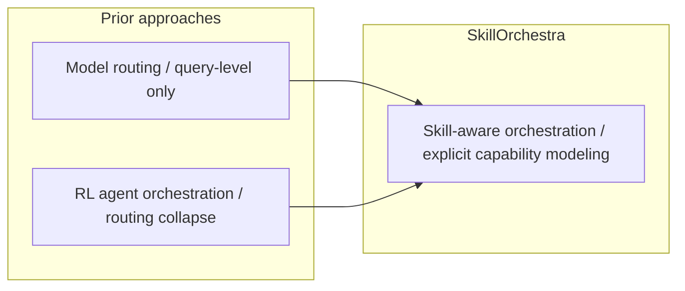
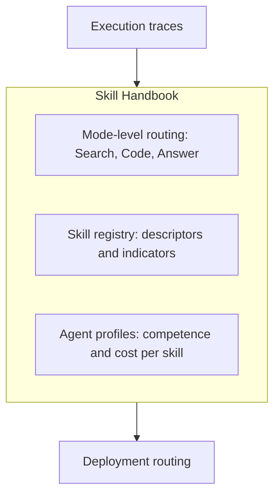
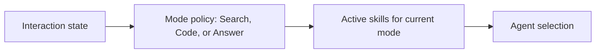
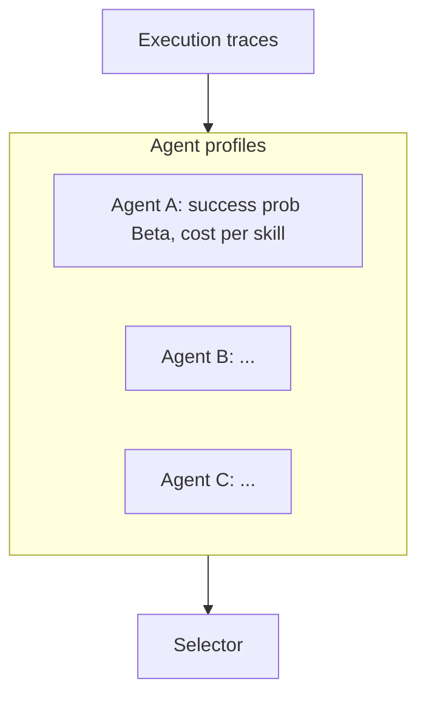
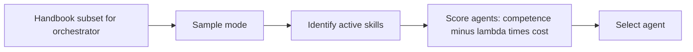
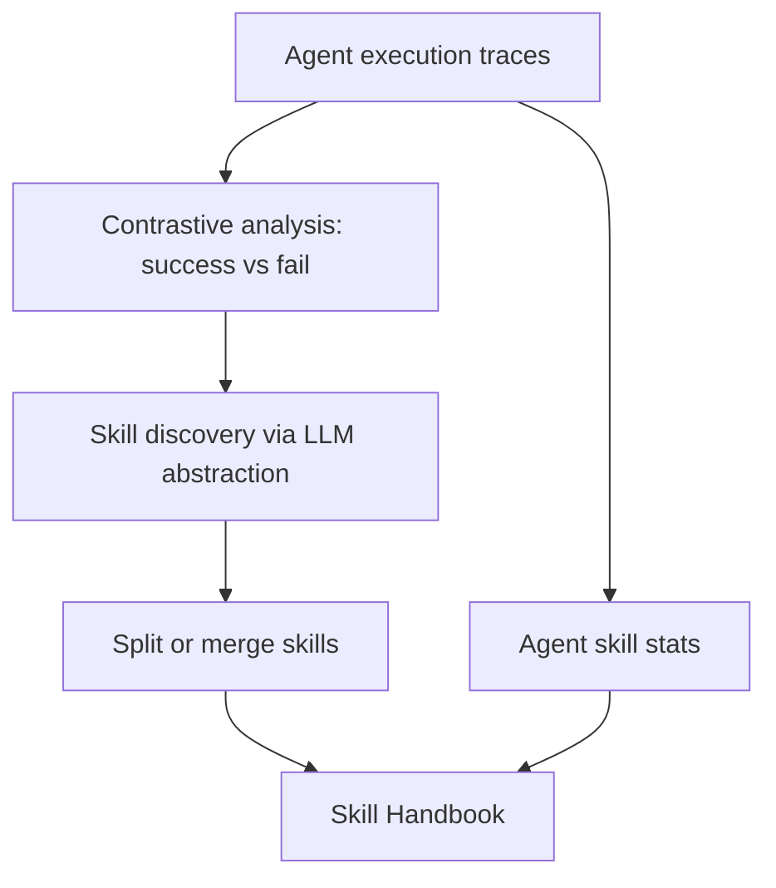
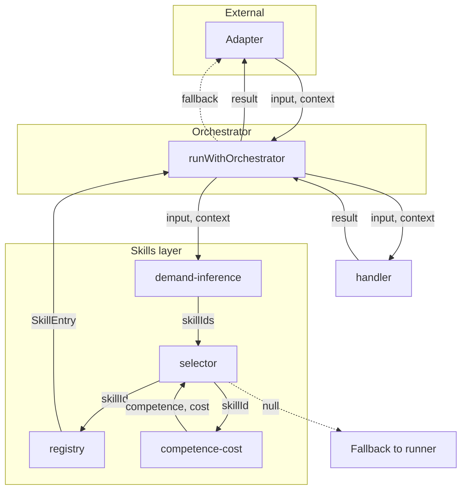
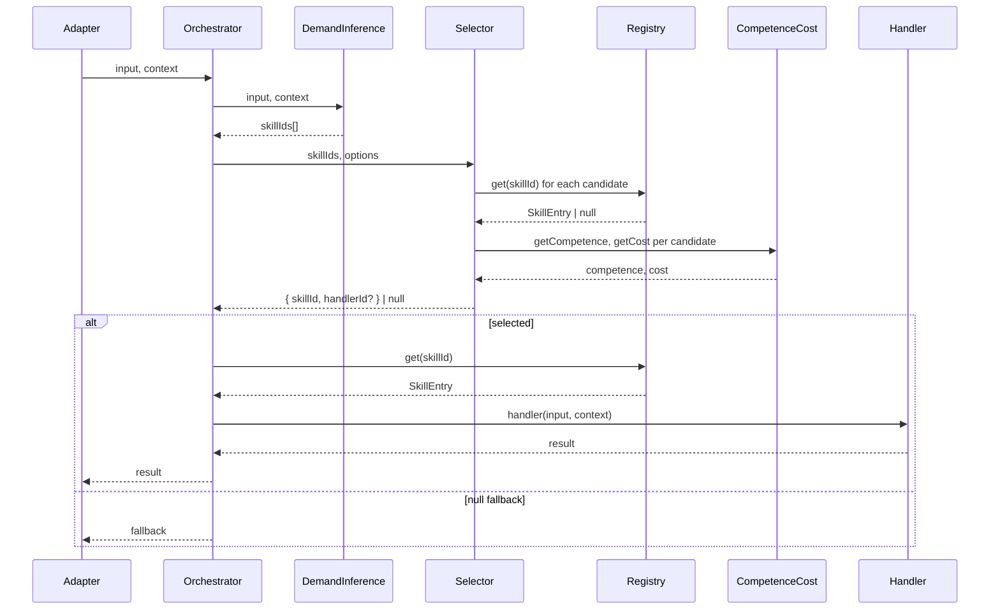
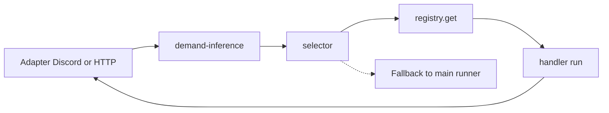

# Skill Orchestrator Plan: Agent Skills

Plan for a minimal skill orchestrator (build our own), aligned with SkillOrchestra (arXiv:2602.19672). Each component is broken down with research context, diagrams, testing results, and concise notes.

**References:** [references.md](./references.md) — arXiv PDF, Emergent Mind, GitHub, related papers.

**Diagrams:** Flowcharts use Mermaid. They render on GitHub and in VS Code with an extension like "Markdown Preview Mermaid Support". If you only see raw code, use the **text version** under each diagram.

---

## Overview & build vs use

| Build our own | Use SkillOrchestra |
|---------------|--------------------|
| TypeScript, fits agent-v2; ship now | Research stack (Python/ML); code not fully released |
| Thin router: registry + demand + selector | Full framework: skill discovery, Beta posteriors, Pareto validation |
| Start rule/keyword or small classifier; add learning later | Learned competence/cost from traces |

**Recommendation:** Build our own minimal orchestrator that implements the same *ideas* (skill demand, competence, cost, selection). Revisit SkillOrchestra when code is available and we have enough traces to justify a learned router.

---

## Research diagram: orchestration paradigms (Paper Figure 1)

*Plain preview — text version:* Prior approaches (Model routing, RL agent orchestration) → SkillOrchestra (Skill-aware orchestration).

**Note:** Input-level routers make one coarse decision; RL orchestrators often collapse to one model. Skill-aware orchestration reasons over explicit skills and competence/cost.

---

## 1. Skill registry (Skill Handbook)

**What it is:** A catalog of named skills + how to run them (handler/tool/agent). In the paper: “registry of fine-grained, reusable skills with natural language descriptors and contextual indicators.”

**Research diagram (Paper Figure 3 & 4 — left/centre):**

*Plain preview — text version:* Execution traces → Skill Handbook (Modes, Registry, Profiles) → Deployment routing.

**Minimal for us:** In-memory map `skillId → { description?, handler }`. Optional: align with Cursor `.cursor/skills` or file/DB later.

**Testing (paper):** Skill refinement (split/merge) and “orchestrator-specific subset” selection are essential; over-fine or over-coarse skills degrade results. Ablation: disabling fine-grained skills −4.6 pt accuracy, +11.7% cost.

**Notes:** Skills are discovered from successful vs failed trajectories (contrastive + LLM abstraction). We can start with a fixed registry and add discovery later.

---

## 2. Skill demand inference

**What it is:** From current user input (and context), decide *which skill(s)* are needed. Single or multi-skill.

**Research diagram (Paper §4.3, deployment):**

*Plain preview — text version:* Interaction state → Mode policy → Active skills → Agent selection.

**Paper:** Orchestrator “identifies a set of relevant skills” via “indicators” and nearest-neighbor retrieval; concrete algorithm/accuracy not fully specified (knowledge gap).

**Minimal for us:** Rule-based (keywords, channel) or one small classifier LLM call (“which skill: audit | qa | research | general?”).

**Notes:** Demand drives routing; wrong demand → wrong agent. Start simple; tune with logs.

---

## 3. Competence & cost model

**What it is:** Per (agent, skill): *how well* the agent performs (success probability) and *how much* it costs (latency, tokens).

**Research diagram (Paper Figure 4 — right):**

*Plain preview — text version:* Execution traces → Agent profiles (Agent A, B, C: competence + cost per skill) → Selector.

**Paper:** Success probability per (agent, skill) modeled as Beta-Bernoulli; cost from execution stats. Aggregation: “weighted per-skill Beta means” for selection.

**Minimal for us:** Static config (e.g. “audit → codebase-auditor”). Later: update from traces (success/fail, latency).

**Testing (paper):** Competence-aware routing avoids routing collapse (e.g. Router-R1 → 98.02% to one model; SkillOrchestra → balanced, e.g. Mixtral 44.53%, Qwen2.5-7B 25.99%).

**Notes:** Paper assumes independence per skill; correlations and non-stationarity are open issues.

---

## 4. Selector (skill-grounded agent routing)

**What it is:** Given demanded skills, competence, and cost, pick the agent (or skill handler) that best satisfies a performance–cost trade-off.

**Research diagram (Paper Figure 3 — right):**

*Plain preview — text version:* Handbook subset → Sample mode → Identify active skills → Score agents (competence − λ·cost) → Select agent.

**Paper:** “Select the agent maximizing expected skill competence minus cost,” with trade-off hyperparameter λ. Pareto-optimal validation selects handbook granularity per orchestrator.

**Minimal for us:** “Best competence for top demanded skill; tie-break by cost.” Optional λ for cost sensitivity.

**Testing (paper):** SkillOrchestra lies on Pareto frontier (higher accuracy at lower or equal cost vs baselines). ~700× and ~300× learning cost reduction vs Router-R1 and ToolOrchestra.

**Notes:** No explicit exploration/uncertainty in the paper; cold start and shifting environments are open.

---

## 5. Execution trace & learning (optional)

**What it is:** Log per request: input, demanded skill, selected handler, result, latency, tokens. Use to refine demand inference and competence/cost.

**Research diagram (Paper Figure 3 — left):**

*Plain preview — text version:* Traces → Contrastive analysis → Skill discovery → Split/merge → Handbook; Traces → Agent skill stats → Handbook.

**Paper:** Skill discovery from success/fail trajectories; agent profiles from aggregated stats. No RL; handbook built from traces.

**Minimal for us:** Not required for v1. Add when we want data-driven routing (and have Log Handler + fields like skill_id, handler, latency).

---

## Testing results (from paper)

| Metric | Result |
|--------|--------|
| **Accuracy vs RL** | Up to **+22.5** percentage points over Router-R1 |
| **Learning cost** | **~700×** reduction vs Router-R1, **~300×** vs ToolOrchestra |
| **Routing collapse** | Router-R1 → 98.02% to one model; SkillOrchestra → balanced allocation |
| **Handbook transfer** | Same handbook to stronger orchestrator → improved accuracy without retraining |
| **Benchmarks** | Ten (QA, math, agent orchestration); SkillOrchestra on Pareto frontier |
| **Ablation** | Fine-grained skills critical: −4.6 pt accuracy, +11.7% cost when disabled |

**Table 1 (paper):** QA datasets — SkillOrchestra bold/second in columns; SkillOrchestra+ with orchestrator switching gives best. See [arXiv PDF](https://arxiv.org/pdf/2602.19672) for exact numbers.

---

## Notes & knowledge gaps (from Emergent Mind)

- **Active skill detection:** Precision/recall of “identify relevant skills” not evaluated; routing sensitive to misidentification.  
- **Mode policy:** How mode selection is learned/updated and when to terminate (e.g. switch Search→Code) not fully specified.  
- **Uncertainty:** Routing uses posterior means; no explicit exploration/exploitation or cold-start handling.  
- **Skill granularity:** Pareto validation can overfit to validation set and λ; robustness across domains/budgets unclear.  
- **Skill discovery:** LLM-based discoverer/reflector heuristic; reproducibility and human oversight not fully addressed.

---

## Our implementation (agent-v2)

We build a minimal skill orchestrator in TypeScript under `agent-v2/src/skills/`. Each component starts simple; we can add learning or refinement later.

**Summary**

| Component | Location | v1 approach |
|-----------|----------|-------------|
| Skill registry | `src/skills/registry.ts` | In-memory map; optional file/DB or `.cursor/skills` later |
| Demand inference | `src/skills/demand-inference.ts` | Rules (keywords, channel) or one small classifier LLM call |
| Competence & cost | `src/skills/competence-cost.ts` | Static config (skill → handler, optional cost tier) |
| Selector | `src/skills/selector.ts` | Best competence for demanded skill; tie-break by cost; optional λ |
| Trace / learning | Log Handler + meta | Add `skill_id`, `handler`, `latency` to log meta; learning pipeline later |

**Placement:** Either (A) orchestrator in front of runner (adapter → orchestrator → runner with single `invoke_skill` tool), or (B) meta-tool `use_skill(skill_id, input)` used by runner, with selector + registry behind it.

---

### Component workflow and I/O (overview)

**I/O between components**

| From | To | Inputs passed | Outputs returned |
|------|-----|---------------|------------------|
| Adapter / Runner | Orchestrator | input, context (channel?, channelId?, requestId?) | result or { fallback: true } |
| Orchestrator | Demand inference | input, context | skillIds: string[] |
| Orchestrator | Selector | skillIds, options? (lambda?) | { skillId, handlerId? } or null |
| Selector | Registry | skillId (per candidate) | SkillEntry or null |
| Selector | Competence-cost | skillId, handlerId? | competence: number, cost: number |
| Orchestrator | Registry | skillId (from select) | SkillEntry (then run handler) |
| Registry | Handler | input, context | Promise<unknown> (handler result) |

**Workflow diagram (data flow; I/O in table above)**

*Plain preview — text version:* Adapter → Orchestrator (input, context) → demand-inference (skillIds) → selector (uses registry + competence-cost) → handler → result back to Adapter; or selector returns null → fallback to runner.

**Sequence (call order)**

*Plain preview — text version:* 1. Adapter → Orchestrator (input, context). 2. Orchestrator → DemandInference → skillIds. 3. Orchestrator → Selector (skillIds); Selector → Registry + CompetenceCost → choice. 4. If selected: Orchestrator → Registry → Handler → result → Adapter. 5. If null: Orchestrator → Adapter (fallback).

---

### 1. Skill registry (`src/skills/registry.ts`)

- **Purpose:** Single source of truth for which skills exist and how to run them. No discovery or refinement in v1.
- **API (minimal):**
  - `register(skillId: string, handler: SkillHandler, description?: string): void`
  - `get(skillId: string): SkillEntry | null`
  - `list(): SkillEntry[]`
- **Types:** `SkillHandler = (input: unknown, context?: SkillContext) => Promise<unknown>`. `SkillEntry = { skillId, handler, description? }`. Optional `SkillContext`: requestId, channel, channelId.
- **Data:** In-memory `Map<string, SkillEntry>`. Populated at startup from config or a small JSON/file; later can sync from `.cursor/skills` or DB.
- **I/O:**
  - **Inputs:** `register`: skillId, handler, description?. `get`: skillId. `list`: none.
  - **Outputs:** `register`: void. `get`: SkillEntry | null. `list`: SkillEntry[].
- **Integration:** Selector and demand-inference both use the registry (selector to resolve skillId → handler; demand-inference to know valid skill ids for rules or classifier).

---

### 2. Demand inference (`src/skills/demand-inference.ts`)

- **Purpose:** From the current request (and optional context), return one or more skill ids that should handle it. Replaces “one big agent does everything” with “route to the right skill.”
- **API (minimal):**
  - `inferDemand(input: string, context?: { channel?: string; channelId?: string }): Promise<string[]>`
- **I/O:**
  - **Inputs:** input: string (user message or request body), optional context: { channel?, channelId? }.
  - **Outputs:** Promise<string[]> — skill ids ordered by relevance (first = primary). Empty array if no match.
- **v1 implementation:**  
  - **Option A (rules):** Keyword/regex rules per skill (e.g. “audit”, “API” → `codebase-auditor`; “test”, “QA” → `jeff-the-auditor`). Channel can override (e.g. Discord vs UIClient).  
  - **Option B (classifier):** One small LLM call or local classifier: “Given this user message and channel, which skill: audit | qa | research | general?” Return single skill id or ranked list.  
- **Integration:** Adapter or runner calls `inferDemand` before selecting a handler; result is passed to the selector. Log demand result (e.g. in Log Handler meta) for tuning.

---

### 3. Competence & cost (`src/skills/competence-cost.ts`)

- **Purpose:** For each (skill, handler) pair, expose “how good” and “how expensive” so the selector can trade off performance vs cost. No learning in v1.
- **API (minimal):**
  - `getCompetence(skillId: string, handlerId?: string): number` — e.g. 0–1 or tier (1 = best).  
  - `getCost(skillId: string, handlerId?: string): number` — e.g. relative cost (tokens/latency tier) or 1/2/3.  
  - Optional: `getProfile(skillId: string): { competence: number; cost: number }[]` per handler.
- **I/O:**
  - **Inputs:** skillId (required), optional handlerId. For getProfile: skillId only.
  - **Outputs:** getCompetence / getCost: number (0–1 or tier; cost 1/2/3). getProfile: array of { competence, cost } per handler.
- **v1 implementation:** Static config (e.g. JSON or in-code map). Example: `{ "codebase-auditor": { competence: 1, cost: 2 }, "jeff-the-auditor": { competence: 1, cost: 2 } }`. Single handler per skill in v1 is fine; multiple handlers per skill when we add alternatives later.
- **Integration:** Selector calls `getCompetence` and `getCost` when scoring; optional λ in selector to weight cost vs competence.

---

### 4. Selector (`src/skills/selector.ts`)

- **Purpose:** Given demanded skill(s), pick the handler to invoke. Implements “best competence for the demand; tie-break by cost” (and optional λ).
- **API (minimal):**
  - `select(skillIds: string[], options?: { lambda?: number }): Promise<{ skillId: string; handlerId?: string } | null>`
- **I/O:**
  - **Inputs:** skillIds: string[] (from demand-inference, ordered by relevance), optional options: { lambda?: number }.
  - **Outputs:** Promise of { skillId, handlerId? } or null. null when no handler available for any demanded skill.
- **v1 logic:** For the first (or primary) skill id in `skillIds`, get all handlers that can serve it from the registry; score each with `competence - lambda * cost` (from competence-cost module); return the best. If no handlers, return null and let caller fall back to general agent or error.
- **Integration:** Called by the orchestrator entry point (adapter or meta-tool). Log selected skillId and handler in Log Handler for observability and future learning.

---

### 5. Orchestrator entry and placement (`src/skills/orchestrator.ts`)

- **Purpose:** Single entry that wires demand-inference → selector → registry → handler run (or fallback).
- **I/O:**
  - **Inputs:** input: string (user message), context: { channel?, channelId?, requestId? } (and any SkillContext fields for the handler).
  - **Outputs:** Promise of handler result (unknown) or a fallback signal (e.g. { fallback: true }) when select returns null so the adapter can call the main runner.
- **Single entry:** `src/skills/orchestrator.ts` (or `index.ts`) exposes one function, e.g. `runWithOrchestrator(input, context)`: call `inferDemand` → `select` → invoke `registry.get(skillId).handler(input, context)`; return result. On null select, optionally call main agent runner instead (fallback).
- **Placement A — In front of runner:** Adapter (Discord or HTTP) calls `runWithOrchestrator` first. If orchestrator returns a result, send it back; otherwise forward to the main agent runner. Runner then only sees “fallback” traffic; tools can stay as today.
- **Placement B — Meta-tool:** Runner has one tool `use_skill(skill_id?: string, input?: string)`. If `skill_id` omitted, the tool implementation calls `inferDemand` then `select`, then runs the chosen handler. If `skill_id` provided, run that skill’s handler directly (optional shortcut). Same registry and selector used under the hood.
- **Logging:** Every orchestrator path should set Log Handler meta: `channel`, `skill_id` (demanded and selected), `handler`, and optionally `requestId`, `phase: 'orchestrator'`. Add `latency` when we have timing.

---

### 6. Trace and learning (later)

- **Now:** Rely on existing Log Handler. Add optional meta fields: `skill_id`, `handler`, `demand_result` (from inferDemand), `latency_ms`. No code in `src/skills/` for learning yet.
- **Later:** Pipeline that reads logs (or a dedicated trace table), aggregates success/fail and latency per (skill, handler), and updates competence-cost (e.g. from static config to file or DB). Optional: skill discovery (split/merge) from traces; start with manual registry updates.

---

### Implementation flow (our pipeline)

*Plain preview — text version:* Adapter → demand-inference → selector → registry.get → handler run → Adapter; or selector → Fallback to main runner.

---

## Diagrams & figures (original)

The Mermaid diagrams in this plan are derived from the paper. For the **original figures and tables** see:

- **[arXiv PDF](https://arxiv.org/pdf/2602.19672)** — Figures 1–5, Table 1 (QA results).
- **Figure 1** — Comparison: model routing vs direct agent orchestration vs skill-aware orchestration.
- **Figure 2** — Left: routing collapse (Router-R1); Right: handbook transfer to stronger orchestrator.
- **Figure 3** — Full SkillOrchestra pipeline: handbook construction → Pareto selection → deployment routing.
- **Figure 4** — Skill Handbook instantiation: mode-level insights, skill registry, agent profiles.
- **Figure 5** — Performance–cost tradeoffs (Pareto frontier) across baselines.

## References

See [references.md](./references.md) for arXiv, Emergent Mind, GitHub, and related papers.
