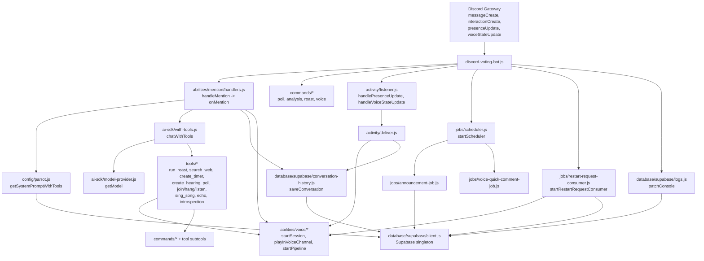

# Agent Architecture

Internal reference for runtime flow and dependency navigation.
Entrypoint: `agent/discord-voting-bot.js`.

## Diagram Legend

- Arrow `A --> B` means "A directly imports/calls B" (good candidate for VS Code "Find References").
- Node labels include concrete files and primary exported entrypoints.
- Keep this document aligned with module boundaries, not individual implementation details.

## Runtime High-Level Flow

## Dependency Map (Reference-First)

Use this as a "where to start Find References" index in VS Code.

| File (owner) | Primary exported symbols | Typical inbound references |
|---|---|---|
| `discord-voting-bot.js` | app wiring only | process entrypoint |
| `abilities/mention/index.js` | `handleMention`, `isBotMentionedByRole` | `discord-voting-bot.js` |
| `abilities/mention/handlers.js` | `onMention`, `handleMention` | `abilities/mention/index.js` |
| `ai-sdk/with-tools.js` | `chatWithTools`, `buildTools` | mention handler, voice pipeline |
| `config/parrot.js` | `refreshPromptConfig`, `getSystemPromptWithTools` | startup path, mention flow, voice pipeline |
| `abilities/voice/index.js` | session and playback APIs | mention flow, slash voice, tools, activity delivery |
| `abilities/voice/pipeline.js` | `startPipeline`, `stopPipeline` | mention flow, slash voice command path |
| `jobs/scheduler.js` | `startScheduler` | `discord-voting-bot.js` only |
| `jobs/restart-request-consumer.js` | `startRestartRequestConsumer`, `processOne` | `discord-voting-bot.js` only |
| `activity/listener.js` | `init`, `handlePresenceUpdate`, `handleVoiceStateUpdate` | `discord-voting-bot.js` |
| `database/supabase/client.js` | `getClient` | all Supabase adapters |

## Navigation Queries (VS Code / ripgrep)

These queries map directly to dependency and reference tracing:

- `startScheduler(` -> scheduler call sites.
- `startRestartRequestConsumer(` -> restart consumer call sites.
- `chatWithTools(` -> all LLM + tools entrypoints.
- `startPipeline(` and `stopPipeline(` -> voice streaming lifecycle.
- `getSystemPromptWithTools(` -> personality prompt assembly callers.
- `getClient(` -> all Supabase data edges.

## Paths and Triggers

| Path | Trigger | Main flow |
|---|---|---|
| `@mention` | `messageCreate` + bot mention + allowed channel | mention handler -> prompt config -> `chatWithTools` -> tools/model -> Discord reply; optional voice output and conversation save |
| Slash commands | `interactionCreate` | command router -> poll/analysis/roast/voice handlers |
| Voice session | `/voice ...` or tool-triggered voice actions | session start -> pipeline STT -> LLM/tools -> TTS playback + voice-session persistence |
| Activity triggers | `presenceUpdate` / `voiceStateUpdate` | trigger detection -> cooldown -> delivery (text/voice/DM) |
| Background | bot ready startup | scheduler (announcement + quick voice comment) and restart request polling |

## Notes on Current Boundaries

- `jobs/scheduler.js` does not own restart request polling; `restart-request-consumer.js` is started separately from `discord-voting-bot.js`.
- `database/supabase/logs.js` patches `console` globally, so log writes are a cross-cutting side effect.
- `config/parrot.js` is the central personality/runtime config layer and depends on multiple Supabase-backed tables.

*** Arch. Recommendation: *** Introduce an explicit application bootstrap module (for example `agent/app/bootstrap.js`) that owns startup wiring (`patchConsole`, command registration, `startScheduler`, `startRestartRequestConsumer`, activity init). This reduces entrypoint sprawl and makes initialization order testable.

*** Arch. Recommendation: *** Define a single `Ports` interface layer for external systems (Discord, Supabase, OpenAI/Tavily) and pass dependencies into handlers instead of importing globals directly. This will shrink blast radius when swapping providers and improve unit-test coverage.

*** Arch. Recommendation: *** Split "runtime flow docs" and "dependency graph docs" into two files (`architecture-runtime.md` and `architecture-dependencies.md`) generated from a lightweight script (`madge` or `dependency-cruiser`) to keep docs from drifting.

*** Arch. Recommendation: *** Resolve or remove unresolved dependency calls in `abilities/mention/handlers.js` (current direct calls to `playInTextChannel(...)` have no local import/export target). Undefined runtime edges break architectural traceability and can fail mention reply delivery.
