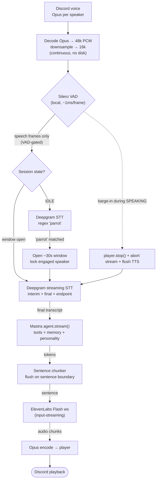
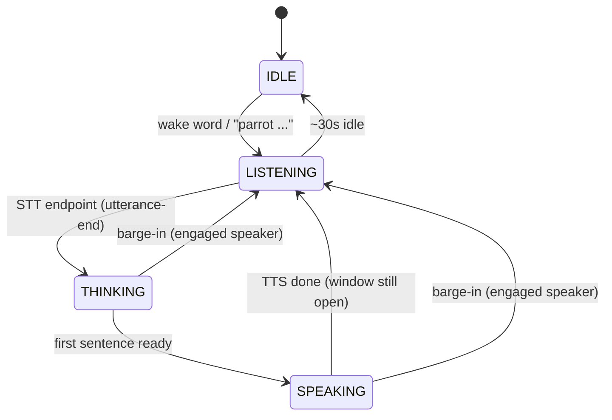

# Voice Plan — Streaming Conversational Voice (Task 5)

Detailed design for the **v2 voice adapter** ([`plan.md`](../plan.md) Task 5). v1's pipeline
works but feels broken — multi-second lag before any reply, and it cannot be interrupted.
This doc says **how to build Task 5 so voice is actually seamless**, within the v2
NestJS + Mastra boundary rule. It supersedes a naive "port v1's pipeline" reading of Task 5.

> Companion: `../../docs/voice-pipeline-findings-and-changes.md` (root) = v1's hard-won
> Opus→PCM/ffmpeg lessons. Reuse the **decode** knowledge; replace the **batch/sequential** shape.

---

## Why v1 is slow (root cause)

v1 ([`agent/abilities/voice/pipeline.js`](../../agent/abilities/voice/pipeline.js)) is **fully batch and sequential** —
every stage is a hard barrier that completes before the next starts:

1. Collect audio: wait for Discord `AfterSilence` (500ms) **or an 8s timeout** (`pipeline.js:25,76`).
2. Decode Opus→PCM in memory, **write PCM to disk**, **spawn ffmpeg** to write an MP3 to disk (`pipeline.js:126-140`).
3. Upload the whole MP3 to **batch Whisper** — 1–3s (`stt.js`).
4. **Non-streaming** `generateText` — wait for the *entire* completion, 0.5–3s (`pipeline.js:218`).
5. Generate the **full** ElevenLabs MP3, download it, *then* play the first word — 0.5–2s (`tts.js`).

Nothing streams; nothing overlaps. First audio lands **3–18s** after you stop talking.
Interruptions are impossible by construction: a single `processingTurn` boolean
(`pipeline.js:43,68`) **drops any speech while the bot is talking or thinking**, and
there is no VAD — endpointing is Discord's crude silence flag plus the 8s safety timeout.

**The fix is architectural, not a faster model:** stream every stage, pipeline them so TTS
starts on the first sentence, and add VAD-driven barge-in.

---

## Approach: streaming cascade (Mastra stays the brain)

Keep STT / agent / TTS as separate best-of-breed services, but make each **stream** and **overlap**:

```
Discord Opus (per speaker)
   │  decode + downsample (continuous, no disk)
   ▼
[Silero VAD]  ──speech?──►  IDLE: gate STT, regex "parrot" ──► conversational window open
   │                                         │
   ▼ (speech frames only — VAD-gated)        ▼
Streaming STT  ──interim+final, endpointing──►  Mastra agent.stream()
                                                  │ tools + memory + personality
                                                  │ tokens → sentence chunker
                                                  ▼
                                          Streaming TTS (sentence-by-sentence)
                                                  │ audio chunks
                                                  ▼
                                          Opus encode → Discord player
   ▲                                              │
   └──────── barge-in: VAD fires during SPEAKING ─┘  (stop player, abort LLM, flush TTS)
```

### Pipeline dataflow



**Why cascade and not speech-to-speech (OpenAI Realtime / Gemini Live):** a realtime model
*is* the agent — tools, personality (`parrot_*` tables), and Mastra memory would move out of
`core/` into the realtime session, breaking both the "tools in the agent loop" requirement
and the v2 boundary rule. The cascade keeps Mastra as the core (STT/TTS/VAD are adapter
concerns) and keeps the TTS vendor swappable. A realtime model can later replace **just the
STT+endpointing layer** behind `SttPort` — see "Future realtime swap-in."

**Target latency (user stops → first bot audio): ~0.8–1.5s.** **Barge-in stop < 200ms.**

---

## Component recommendations & tools

| Stage | Recommendation | Why / notes |
|------|----------------|-------------|
| **VAD** | **Silero VAD** via `onnxruntime-node` (or `@ricky0123/vad-node`) | Tiny ONNX model, ~1ms/frame, local on the 48k→16k PCM. Drives endpointing assist **and barge-in** so we don't pay cloud STT to notice the user started talking. |
| **Wake word** | **VAD-gated Deepgram + "parrot" regex** | Silero VAD (already in the pipeline) gates the cloud STT: in IDLE, only **speech** frames reach Deepgram; silence is free. Regex the transcript for the trigger to open the window. **No extra vendor/account.** (A local Porcupine wake-word is the optimization if idle STT spend ever matters — same boundary.) |
| **Streaming STT** | **Deepgram Nova-3** (websocket, `@deepgram/sdk`) | Voice-agent default: ~100–300ms, interim + final, **built-in endpointing/utterance-end**, cheap. Replaces batch Whisper. Alt: OpenAI `gpt-4o-transcribe` streaming (one fewer vendor — already have `OPENAI_API_KEY`). OSS: self-hosted faster-whisper streaming (infra burden). |
| **Agent** | **Mastra `agent.stream()`** with tools/memory/personality | Already the v2 core. Stream tokens; keep the **separate `voice_model`** (fast model) v1 supports. Tools run in the loop unchanged. |
| **Sentence chunker** | small util in `voice/` — buffer tokens, flush on sentence/clause boundary | The key pipelining trick: forward the **first complete sentence** to TTS instead of waiting for the full completion. This is what gets first-audio under ~1.5s. |
| **Streaming TTS** | **ElevenLabs websocket input-streaming** + `eleven_flash_v2_5` (~75ms) | Keep for now (v1 already uses Flash for quick comments — `tts.js:23`). Feed sentence chunks in, get audio out; multi-context socket supports flush/interrupt. **Swappable** behind `TtsPort`. Lower-latency commercial alt: **Cartesia Sonic**. OSS: **Kokoro** (tiny, self-host). |
| **Audio out** | ElevenLabs mp3/pcm chunks → **streaming** `createAudioResource(StreamType.Arbitrary)` (prism-media/ffmpeg transcodes → 48k Opus) | ⚠️ A transcode hop is **unavoidable** (Discord needs 48kHz **stereo**; ElevenLabs PCM tops out at 44.1kHz **mono**). The win over v1 is that it's **streaming, not a per-turn file+ffmpeg-spawn** — no disk, starts on the first chunk. Don't try to hand-feed `StreamType.Raw`; let prism handle the resample. |

**Vendor delta from v1:** drop batch-Whisper file path → add Deepgram (STT) + Silero VAD
(open-source, no account). Keep ElevenLabs (now streaming). Keep Mastra. **New env: `DEEPGRAM_API_KEY`** (only one new key).

---

## Turn-taking: wake-word-then-open window

A per-session **state machine** replaces v1's `processingTurn` boolean:

```
IDLE  ──("parrot ..." matched in VAD-gated STT)──►  LISTENING
LISTENING ──(STT endpoint / utterance-end)──►  THINKING
THINKING ──(first sentence ready)──►  SPEAKING
SPEAKING ──(TTS done)──►  LISTENING            [window still open]
LISTENING ──(window idle timeout ~30s)──►  IDLE
{LISTENING|THINKING|SPEAKING} ──(barge-in VAD, engaged speaker)──►  LISTENING
```



- **Wake word opens a ~30s conversational window** (reset on each exchange). Inside it, open-mic
  back-and-forth with no "parrot" prefix needed.
- Idle window → back to IDLE (armed, only wake word wakes it). Keeps it from talking over a busy
  group call and caps STT/LLM cost.
- **Engaged-speaker lock:** the speaker who opens the window owns the turn (Discord receiver
  streams are per-`userId`), so cross-talk doesn't hijack it. Optionally widen to the allowlist.

---

## Barge-in (the biggest UX win)

While `SPEAKING`, keep VAD on the engaged speaker's frames. On sustained speech (>~250ms):

1. `player.stop()` immediately (kills playback).
2. `abortController.abort()` on the in-flight Mastra stream.
3. Flush/close the TTS websocket context.
4. Truncate the assistant turn in history to **what was actually spoken** (best-effort), then → `LISTENING`.

Self-echo is a non-issue: Discord's receiver doesn't loop the bot's own playback back, and streams are keyed by `userId`.

---

## Fit with v2 ports & adapters

Per [`architecture.md`](architecture.md) — deps point inward; Discord/Nest stay out of `core/`:

- **`core/`** — Mastra agent exposes the **streaming** method (tokens + tool events). New ports
  (plain types only) in `core/ports/`: `SttPort`, `TtsPort`, `VadPort` — alongside
  the existing `VoiceSink` (audio out). (No `WakeWordPort`: IDLE wake = regex over VAD-gated STT in the orchestrator.)
- **`platforms/discord/voice/`** (Necord) — the streaming **orchestrator** (state machine) +
  Discord-specific bits: receiver→PCM ingest, Opus encode→player. `join_voice` stays a Discord-only tool.
- **`infra/`** — `DeepgramStt` (`stt.service.ts`), `ElevenLabsTts` (`tts.service.ts`), `SileroVad`
  implement the ports. Swapping ElevenLabs→Cartesia = one adapter.
- **Persistence + memory** — voice turns share the text Mastra thread
  (`thread = discord:${channelId}`, `resource = discord:${userId}` — decision #3, resolves G12),
  **and** write `voice_sessions` / `voice_session_turns` rows for session lifecycle/analytics
  (port v1 `agent/database/supabase/voice-sessions.js`).
- **Quick-comment job** (activity one-liners) → Task 6, reusing `TtsPort`.

**Future realtime swap-in:** because STT+endpointing sits behind `SttPort`, Deepgram can later be
replaced by OpenAI Realtime *transcription sessions* — or a full speech-to-speech "fast path" behind
a feature flag — **without touching the agent or tools.**

---

## NestJS integration & file layout

NestJS is just DI + lifecycle over Node; the pipeline is event-driven async I/O and needs no
special framework support. The **one design rule that matters**: Nest providers are singletons,
so **per-session state cannot be a provider.** The orchestrator/state-machine is a **plain class
instantiated per voice session** by a singleton manager (exactly how v1's `sessionsByGuild` Map
holds plain session objects — [`session.js:29`](../../agent/abilities/voice/session.js)). The
stateless adapters (STT/TTS/VAD/wake-word) **are** singleton `@Injectable` providers, injected into
each session.

```
src/
  core/ports/
    stt.port.ts          # start(opts) → emits partial / final / utteranceEnd
    tts.port.ts          # synthesize(sentenceStream) → audio chunks; flush(); close()
    vad.port.ts          # process(frame16k) → { isSpeech, prob }
    voice-sink.port.ts   # (existing) audio out
    # (no wake-word port — IDLE wake = regex over VAD-gated STT, in the orchestrator)
  platforms/discord/voice/
    voice.module.ts          # Necord submodule; wires providers
    voice-session.manager.ts # @Injectable singleton: Map<guildId, VoiceSession>; OnModuleDestroy → tear down all
    voice-session.ts         # PLAIN class: the IDLE→LISTENING→THINKING→SPEAKING machine, one per guild
    audio-ingest.ts          # receiver.subscribe(Manual) → opus decode → 48k PCM → 16k frames (for VAD/STT)
    audio-output.ts          # TtsPort chunks → prism transcode → Opus → AudioPlayer
    sentence-chunker.ts      # token buffer → sentence flush
    join-voice.tool.ts       # Discord-only tool
  infra/voice/
    deepgram-stt.service.ts        # implements SttPort  (ws)
    elevenlabs-tts.service.ts      # implements TtsPort  (ws, eleven_flash_v2_5)
    silero-vad.service.ts          # implements VadPort  (onnxruntime-node) — also gates IDLE STT
```

**Lifecycle:** open the Deepgram + ElevenLabs websockets **on window-open**, close them on
window-close/idle (don't hold sockets in IDLE — cost). Manager's `OnModuleDestroy` destroys all
voice connections + closes all sockets + releases native handles (rides on Task 1's `enableShutdownHooks`).
**Necord** provides the discord.js `Client` via DI; the voice receiver comes off the connection as in v1.

## Implementation risks (verified against current APIs, 2026-06-10)

| Risk | Verdict | Mitigation |
|------|---------|------------|
| **Barge-in must abort the LLM** | ✅ **Supported.** Mastra `agent.stream({ abortSignal, onAbort })` forwards the signal to in-flight tool executions too. | `AbortController` per turn; `.abort()` on barge-in. Even without it, stopping playback + flushing TTS is enough — the rest is wasted tokens. |
| **TTS audio → Discord format** | ⚠️ **Real friction, solved.** Discord raw PCM needs **48kHz stereo s16le**; ElevenLabs PCM tops out at **44.1kHz mono**. | Feed ElevenLabs **mp3/pcm chunks** into a **streaming** `createAudioResource(StreamType.Arbitrary)` — `prism-media`/ffmpeg transcodes to 48k Opus (deps already present). Streaming, not file-based, so cheap. **Verify first-audio budget holds** through the transcode. |
| **Silero VAD in Node** | ✅ **Mature.** `@ricky0123/vad-node` / `avr-vad` over `onnxruntime-node`; ~1ms per 30ms frame. | Frame-by-frame on the 16k ingest stream. |
| **Native deps in deploy image** | ⚠️ **Watch at deploy.** `onnxruntime-node` (Silero) + `@discordjs/opus` are native. | Bake prebuilt binaries into the Docker image; ties to the open "deployment target" decision. |
| **Mastra `stream()` API churn** | ⚠️ **Newish (v1, Jan 2026).** `stream` vs `streamVNext` naming. | Pin `@mastra/core`; confirm the streaming surface in the Phase-4 spike before building on it. |
| **Discord receive reliability** | ✅ **Net improvement.** v1 fought `AfterSilence`/never-ending streams ([findings doc](../../docs/voice-pipeline-findings-and-changes.md)). | Continuous `EndBehaviorType.Manual` subscription + **our own** VAD/Deepgram endpointing sidesteps the v1 flakiness entirely. |
| **Barge-in history truncation** | ⚠️ **Cosmetic.** Hard to know exactly how much TTS actually played before stop. | Best-effort: mark the turn interrupted; approximate spoken text by elapsed playback time. Doesn't affect function. |
| **CPU at scale** | ✅ **Fine for friend-group.** One guild, few speakers = trivial. | Doesn't scale to many guilds on one event loop; move VAD/wake-word to a worker thread **only if** that ever becomes the use case. |

## Build phases (within Task 5)

> **Phase 0 is a throwaway de-risk spike — mirror the Task 0 memory spike.** Prove the two
> unknowns that can't be known by reading docs **before** committing to vendors/wiring. Go/no-go gate.

0. **De-risk spike (throwaway, no vendor keys for half of it):**
   - **(a) Barge-in loop** — continuous `EndBehaviorType.Manual` receive → Opus decode → 48k PCM → 16k frames → Silero VAD. While playing a dummy audio file, detect the engaged speaker talking and **`player.stop()` in < 200ms**. No cloud.
   - **(b) Mastra stream + abort** — call `agent.stream({ abortSignal, onAbort })`, consume `textStream`, `.abort()` mid-stream, confirm it stops + `onAbort` fires (settles the `stream` vs `streamVNext` surface — pin the version that works).
   - **(c) Output transcode latency** — push one ElevenLabs (or canned mp3) chunk through streaming `createAudioResource(StreamType.Arbitrary)` and **measure time-to-first-audio through the prism/ffmpeg hop**. This is the load-bearing latency unknown.
   - **Gate:** all three pass (barge-in < 200ms, abort works, transcode hop leaves headroom under the 1.5s budget) before Phase 1. On fail: reconsider TTS vendor (Cartesia) or raw-Opus output path.
1. **Ingest + VAD** — productionize Phase 0(a): per-speaker Opus→16k frames, VAD as a `VadPort` adapter.
2. **Streaming STT** — Deepgram websocket: interim + final + utterance-end → transcripts. Verify endpoint latency.
3. **Wake gate + state machine** — IDLE: VAD-gated Deepgram + "parrot" regex opens the ~30s window; engaged-speaker lock.
4. **Streaming agent + sentence chunker** — `agent.stream()`, flush first sentence early.
5. **Streaming TTS out** — ElevenLabs ws input-streaming → Arbitrary transcode → player, sentence-by-sentence.
6. **Barge-in** — stop/abort/flush/truncate on VAD during SPEAKING (productionize Phase 0(a+b)).
7. **Persistence** — `voice_sessions` / `voice_session_turns` rows; auto-end on disconnect.
8. *(Deferred — pull when Deepgram cost > ~$20/mo)* **Local wake tier** — `VoskWakeSvc` for IDLE-mode keyword-spotting; Deepgram websocket opened only on window-open. See [Scale lever](#scale-lever-deferred--pull-when-cost-bites).

## Acceptance (replaces the thin Task 5 gate)

- **Latency:** instrument timestamps at user-endpoint → STT-final → LLM-first-token → TTS-first-audio
  → **transcode** → player-start (the prism/ffmpeg Arbitrary hop is on the critical path — measure it
  separately, see Phase 0c). First-audio **< 1.5s**, logged per turn.
- **Barge-in:** talk over the bot mid-reply → playback stops **< 200ms** and the new utterance is picked up.
- **Wake/window:** ignores a busy channel in IDLE; opens on "parrot"; holds an open-mic exchange;
  returns to IDLE after ~30s idle.
- **Tools in loop:** a tool call (search, timer) runs **inside** the Mastra loop during a voice turn
  and the spoken reply reflects the result.
- **Same brain:** same agent/memory/personality as text; session row persisted; auto-end on disconnect.
- **Swap test:** flip `TtsPort` to a stub/second provider — proves ElevenLabs isn't load-bearing.

## Scale lever (deferred — pull when cost bites)

**Trigger:** Deepgram IDLE-mode spend exceeds ~$20/mo. At friend-group scale this is unlikely before months of heavy use, and the ports abstraction means the swap is mechanical. Don't build now.

### What to build when triggered: two-tier IDLE STT

Replace Deepgram in IDLE with a **local, accountless wake-word detector**. Only open the Deepgram websocket once the window is open (LISTENING state). Deepgram spend drops to *actual conversation time* — essentially zero for casual use.

**Recommended local tier:** **Vosk** (offline STT, Apache 2.0)
- Real Node native bindings (`vosk` npm, pre-built for Node 18+) — unlike openWakeWord (Python only)
- Run keyword-spotting mode with `["parrot", "sir parrot", "[unk]"]` grammar
- 16k mono PCM → model → text locally; no network call, no account
- 40MB model download; runs fine on the same process (or a worker thread if CPU becomes a concern)
- Alt: **openWakeWord** (Python/ONNX, trainable custom "parrot" keyword) — requires a small sidecar or `child_process`; more accurate but more infrastructure

**Implementation sketch (one adapter):**
```
infra/voice/
  vosk-wake.service.ts   # implements SttPort for IDLE state only
                         # grammar = ["parrot", "sir parrot", "[unk]"]
                         # emits { type: "wakeWord" } when "parrot" detected
```
- `VoiceSession` checks `state === IDLE ? voskWake.process(frame) : deepgramStt.process(frame)`
- `SttPort` interface is unchanged — two implementations, selected by state
- Deepgram websocket is never opened until `LISTENING` (opens on wake, closes on idle timeout)
- Native dep: `vosk` (add alongside `onnxruntime-node` in the Docker bake step)

**Acceptance for Phase 8:** wake fires on "parrot" from canned audio without a network call; Deepgram websocket not opened until window opens; swapping back to full-Deepgram IDLE = one line change.

---

## Locked decisions (settled 2026-06-10 — builder: do not re-litigate)

| # | Decision | Choice | Consequence for the build |
|---|----------|--------|---------------------------|
| 1 | **STT vendor** | **Deepgram Nova-3** (websocket, `@deepgram/sdk`) | Use Deepgram's interim+final + built-in endpointing/utterance-end to drive the `LISTENING→THINKING` transition. New env `DEEPGRAM_API_KEY`. Silero VAD is still used for **barge-in** (cheaper than relying on STT to notice speech during playback). |
| 2 | **Wake word** | **VAD-gated Deepgram + "parrot" regex** (no Porcupine) | In IDLE, **Silero VAD gates the cloud STT** — only frames VAD marks as speech go to Deepgram; silence is free. Regex the transcript for "parrot"/"sir parrot" to open the window. **Reuses the stack we already have (no extra vendor, no account, one fewer native dep).** Tradeoff: pays Deepgram for group *speech* during IDLE (≈half a cent / minute of actual talking — negligible at friend-group scale). Porcupine local wake-word remains a drop-in optimization behind the same boundary **if** idle STT cost ever bites. |
| 3 | **Voice memory** | **Shared Mastra thread** | Voice turns use the **same** `thread = discord:${channelId}` / `resource = discord:${userId}` as text (memory-plan.md) — cross-surface memory works (ask in chat → reference in voice). **Also** keep `voice_sessions` / `voice_session_turns` rows for session lifecycle + analytics. This resolves gap-analysis **G12**. |
| 4 | **Barge-in scope** | **Engaged speaker only** | Only the `userId` that opened the window can interrupt (the engaged-speaker lock already tracks this). Ignore VAD from other speakers during SPEAKING. |
